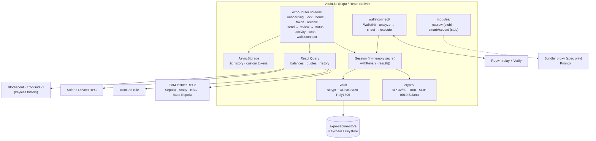

# VaultLite

Self-custodial multi-chain wallet **demo** built with React Native + Expo SDK 58 (expo-router, TypeScript strict). EVM testnets, Tron Nile and Solana Devnet, with WalletConnect (Reown WalletKit), plus extension points for a milestone escrow contract and ERC-4337 smart accounts.

> [!WARNING]
> **TESTNETS ONLY.** VaultLite talks only to Sepolia, Polygon Amoy, BSC Testnet, Base Sepolia, Tron Nile and Solana Devnet. It has not been audited and **must never hold real funds**. Mainnets are deliberately absent from the chain registry, and mainnet chain IDs are rejected in QR codes and WalletConnect requests.

> [!IMPORTANT]
> **Device status: untested on device.** Everything below is implemented and covered by unit tests (107 Jest tests), `tsc`, ESLint and a successful `expo export --platform android`. Read-only network calls (balances, fee estimates, token checks, explorer history) were checked against live testnets from a dev machine. **No dev build has been installed on a phone or emulator yet.** That means these have never run end to end: the camera/QR scanner, WalletConnect sessions with a real dApp, biometrics, haptics, animations, screen-capture blocking, real send / speed-up / cancel transactions, the Solana Devnet balance call, and the Maestro flows. Expect bugs there until device testing is done.

## Media

| | |
|---|---|
| Screenshots | _TODO: `docs/media/home.png`, `send-review.png`, `wc-sheet.png`, `receive.png`_ |
| GIF | _TODO: `docs/media/send-flow.gif`_ |
| Demo video (2–3 min) | _TODO: link_. Shot list: [`docs/DEMO_SCRIPT.md`](docs/DEMO_SCRIPT.md) |
| Android APK (EAS `preview`) | _TODO: link_ |

## Features

**Keys and vault**
- BIP-39 create (with a backup quiz) or import (mnemonic or raw private key).
- Derivation:
  - EVM `m/44'/60'/0'/0/0`
  - Tron `m/44'/195'/0'/0/0`
  - Solana `m/44'/501'/0'/0'` (SLIP-0010 ed25519; checked against `@solana/web3.js`)
- The secret is encrypted with XChaCha20-Poly1305 under a key derived from your PIN with scrypt, and stored in `expo-secure-store`. Optional biometric unlock. The app auto-locks when it goes to the background, and the vault locks after 10 wrong PINs.

**Portfolio**
- Native + ERC-20 balances via viem, TRX + TRC-20 via TronGrid, SOL via Solana JSON-RPC, all through React Query.
- Home: total (test stablecoins counted at $1), chain filter chips, pull-to-refresh, skeletons, pending transactions.
- Token detail, Receive (QR, copy, share).
- Custom token import, checked on-chain (`decimals()` / `symbol()`).

**Send** (EVM native/ERC-20, Tron TRX/TRC-20)
- Address validation: EIP-55 checksum, Tron base58check.
- Address QR scanner. Accepts EIP-681 `ethereum:` codes, including `/transfer` token requests, `tron:` codes and bare addresses.
- Fees:
  - EVM: EIP-1559 slow / normal / fast tiers.
  - Tron: bandwidth/energy estimate and account-activation fee.
- Hold-to-confirm plus biometric or PIN re-auth before signing.
- Status screen polls the receipt and links to the explorer. Stuck EVM transactions can be **sped up or cancelled** (same nonce, fee bumped).
- Local transaction history, plus incoming transfers from **keyless** explorer APIs (Blockscout for Sepolia and Base Sepolia, TronGrid for Nile). Spam and address-poisoning transfers are filtered.

**WalletConnect** (Reown WalletKit)
- Pair by QR or by pasting a `wc:` URI. Session list and disconnect.
- Signing sheet for:
  - `personal_sign`
  - `eth_signTypedData_v4` (readable tree)
  - `eth_sendTransaction` (decoded calldata + fee preview)
  - `wallet_switchEthereumChain`
  - `tron_signMessage` (TronWeb `signMessageV2` compatible)
  - `tron_signTransaction`
- Checks before signing:
  - the chain is a testnet and approved in the session;
  - the account is ours;
  - the chainId in typed data or the transaction matches the request;
  - a Tron transaction's ID matches its raw bytes;
  - duplicate requests are dropped.
- Risk hints: unlimited approve, Permit/Permit2, `setApprovalForAll`, Reown Verify results (invalid domain, unknown domain, known scam). Any "danger" hint turns Approve into a long hold.
- EIP-1193 error codes: 4001, 4100, 4200, 4901, 4902, -32602, -32603.

**UX and safety:** Reanimated micro-interactions, haptics, accessibility labels (hold-to-confirm has a screen-reader action), screenshot blocking on the secret, PIN and signing screens.

## Architecture



Source layout: `src/app` (routes), `src/crypto`, `src/vault`, `src/config` (chains, tokens, env), `src/services` (evm, tron, incoming), `src/lib` (address, fees, amount, scan, errors, spam), `src/store`, `src/walletconnect`, `src/modules/{escrow,smartAccount}`, `src/components`, `src/hooks`.

## Security and threat model

| Threat | Mitigation | Limits |
|---|---|---|
| Device theft / offline extraction | Secret encrypted with a key derived from the PIN (scrypt N=2^14); stored device-only in secure storage; PIN never stored; 10 wrong attempts lock the vault | A 6-digit PIN is brute-forceable offline if storage is dumped from a rooted/jailbroken device. Real wallets need hardware-backed keys and stronger KDF parameters. |
| Shoulder-surfing / screenshots | Mnemonic hidden until tapped; `expo-screen-capture` on sensitive screens | Not verified on device. iOS can only detect, not block, screenshots. |
| Malicious dApp | Method/chain/account allowlists; chainId mismatch rejection; decoded calldata; risk hints; Verify API; biometric/PIN per approval; `eth_sign` refused | Decoding covers common ERC-20/721 calls only; no simulation of balance changes. |
| Phishing / address poisoning | Checksum validation; spam + poisoning filters in Activity; QR rejects mainnet chain IDs | No address book or "first-time recipient" warning yet. |
| Key in memory | Signing keys derived on demand via `withKeys`, not stored; secret cleared on lock/background | JS memory can't be reliably zeroed. |
| API keys in the bundle | Only the Reown project ID (public by design) ships. The Pimlico key stays server-side ([`docs/BUNDLER_PROXY.md`](docs/BUNDLER_PROXY.md)). | Public RPCs are rate-limited and can see your IP and addresses. |
| Supply chain | Lockfile, CI on typecheck/lint/test | No dependency audit/SBOM in CI yet. |

Not audited. Not a production wallet.

## Supported chains

| Chain | ID / CAIP-2 | Balances | Send | WalletConnect | Incoming history |
|---|---|---|---|---|---|
| Ethereum Sepolia | 11155111 | ETH, USDC | ✅ | ✅ | ✅ Blockscout |
| Polygon Amoy | 80002 | POL, USDC | ✅ | ✅ | — (explorer needs key) |
| BNB Smart Chain Testnet | 97 | tBNB | ✅ | ✅ | — (explorer needs key) |
| Base Sepolia | 84532 | ETH, USDC | ✅ | ✅ | ✅ Blockscout |
| Tron Nile | `tron:0xcd8690dc` | TRX, USDT | ✅ | ✅ sign only | ✅ TronGrid |
| Solana Devnet | `solana:EtWTRABZaYq6iMfeYKouRu166VU2xqa1` | SOL | — | — | — |

Curated token addresses come only from official sources (Circle for USDC, the Nile faucet for USDT). BSC Testnet USDC and EVM testnet USDT are omitted because no official addresses exist. ✅ = implemented and unit-tested; see the device-status note above.

## Setup

Requirements: Node ≥ 22, npm, Android Studio / Xcode for local dev builds, or an Expo account for EAS.

```sh
npm install
cp .env.example .env
```

| Variable | Required | Purpose |
|---|---|---|
| `EXPO_PUBLIC_REOWN_PROJECT_ID` | for WalletConnect | Project ID from <https://dashboard.reown.com>. Without it, WalletConnect is disabled. |
| `EXPO_PUBLIC_ESCROW_ADDRESS_BASE_SEPOLIA` | no | MilestoneEscrow deployment (once deployed) |
| `EXPO_PUBLIC_BUNDLER_PROXY_URL` | no | Base URL of the bundler/paymaster proxy |

`EXPO_PUBLIC_*` values are inlined into the JS bundle. Never put secrets in them. `.env` is git-ignored.

**Dev build.** WalletConnect, the camera, secure store and haptics need native modules, so **Expo Go is not enough**:

```sh
npx expo run:android         # local dev build
# or
npx expo start --dev-client  # after installing a dev-client build
```

**EAS** (`eas.json`):

```sh
eas env:create --name EXPO_PUBLIC_REOWN_PROJECT_ID --value <id> --environment development --environment preview
eas build -p android --profile development   # dev client, internal APK
eas build -p android --profile preview       # installable APK
```

Fund the test wallet from the faucets linked on each token screen (Sepolia, Amoy, BNB, Nile, Solana).

## Testing

| Command | What it does |
|---|---|
| `npm run typecheck` | `tsc --noEmit` |
| `npm run lint` | `expo lint` |
| `npm test` | Jest (`jest-expo`), 107 tests: derivation vectors (EVM, Tron, Solana/SLIP-0010), vault crypto, address validation, fee math, Tron signing (TronWeb vector), WalletConnect request analysis and signatures, QR parsing, history, spam, de-dup |
| `npx expo export --platform android` | Bundles the app (passes) |
| `maestro test .maestro/` | E2E: `onboarding-import.yaml` (import → PIN → home → receive → lock/unlock), `onboarding-create.yaml` (up to the backup quiz). **Not yet run**: needs a dev or preview build on an emulator. |

CI: `.github/workflows/ci.yml` runs typecheck, lint and test on push/PR. It's committed but has **never run** (the repo hasn't been pushed).

## Integrations

- **Milestone escrow** (`src/modules/escrow`): ABI, EIP-712 domain and the `EscrowService` interface for the teammate's MilestoneEscrow on Base Sepolia. Currently a stub; turns on once `EXPO_PUBLIC_ESCROW_ADDRESS_BASE_SEPOLIA` is set.
- **ERC-4337 smart account** (`src/modules/smartAccount`): EntryPoint v0.7, single EOA owner, Pimlico bundler + paymaster. Stub; waits on the factory address and the proxy.
- **Bundler proxy** ([`docs/BUNDLER_PROXY.md`](docs/BUNDLER_PROXY.md)): spec for a small Vercel/Next.js route, `POST /api/bundler/:chainId`, with method and chain allowlists (Base Sepolia only), `PIMLICO_API_KEY` server-side, per-IP/per-sender rate limits, a sponsorship policy and CORS. **Not built or deployed.**

Details: [`docs/INTEGRATIONS.md`](docs/INTEGRATIONS.md).

## Roadmap

- [ ] **Device QA:** dev build, Maestro runs, real sends / speed-up / cancel, WalletConnect against the Reown sample dApp, Solana Devnet balance
- [ ] Record screenshots, GIF, demo video; publish the preview APK
- [ ] Smart account via the bundler proxy; escrow flows (create / fund / approve milestone)
- [ ] Solana send and WalletConnect Solana methods
- [ ] Address book and first-time-recipient warning; transaction simulation
- [ ] Hardware-backed keys and stronger KDF settings; dependency audit in CI

## License

Demo project, no warranty. Testnets only.
